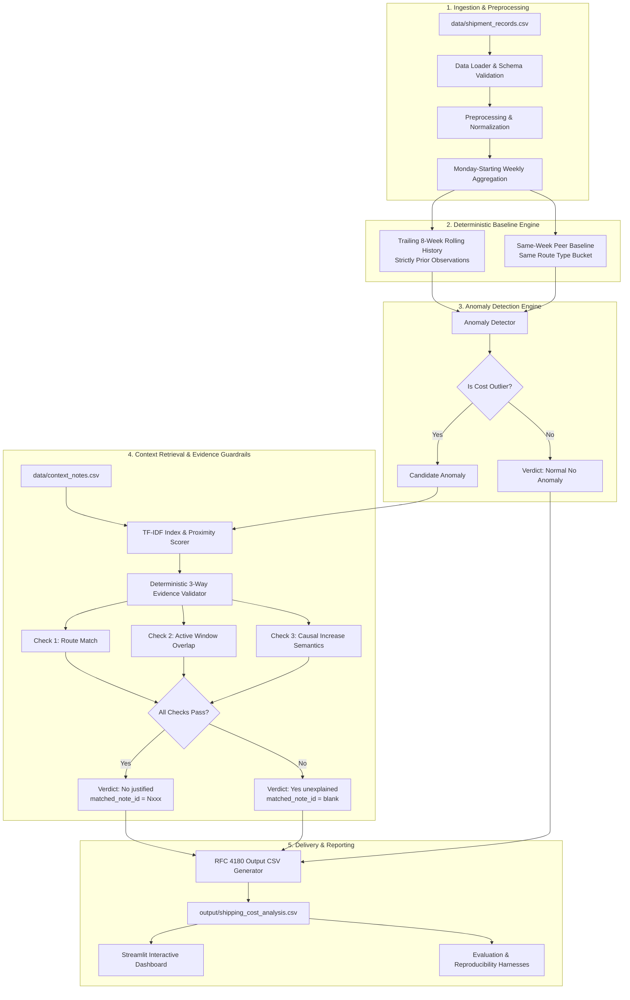

# FreightTiger Freight Intelligence & Corridor Cost Analytics Platform

> **Production-grade Freight Cost Auditing, Trailing Historical & Peer Baselines, Deterministic Anomaly Detection, and Evidence-Grounded Context Retrieval.**

[](https://www.python.org/downloads/)
[]()
[]()
[]()

---

## 1. Problem Statement
In freight and road logistics, shippers pay transporters to move goods across extensive corridor networks. While cost primarily depends on payload weight (tonnes) and route length (kilometres), real-world freight rates fluctuate constantly due to diesel price revisions, monsoon floods, highway repairs, and seasonal surcharges. Over time, costs can creep up on specific routes without a legitimate reason.

The goal of this system is to build an engineering-grade **Freight Cost & Corridor Analytics Platform** that:
1. Aggregates shipment records into Monday-starting weekly route cohorts.
2. Accurately calculates freight cost per tonne-kilometre (`cost_per_tonne_km`).
3. Computes trailing 8-week historical baselines (strictly non-lookahead) and peer route baselines (same week, same length bucket).
4. Deterministically detects unusual cost rises.
5. Employs a context retrieval and evidence validation engine to determine whether anomalies are justified by real-world events or remain unexplained.
6. Emits an exact-contract CSV matching `sample_output_format_v2.csv` with zero hallucination.

---

## 2. Architecture & Data Flow



---

## 3. Installation & Setup

### Environment Prerequisites
- Python 3.11 or higher
- PowerShell, Bash, or Command Prompt
- No external databases, Docker, or paid cloud APIs required.

### Step-by-Step Setup
```bash
# 1. Clone or navigate to the project directory
cd "Freight Tiger"

# 2. Create and activate a virtual environment (optional but recommended)
python -m venv .venv
# On Windows PowerShell:
.venv\Scripts\Activate.ps1
# On Linux/macOS:
source .venv/bin/activate

# 3. Install dependencies
pip install -r requirements.txt
```

---

## 4. Required Dependencies & Environment Variables

### Core Dependencies (`requirements.txt`)
- `pandas>=2.0.0`: High-performance vectorised grouping and date handling.
- `numpy>=1.24.0`: Numerical calculations.
- `scikit-learn>=1.3.0`: Deterministic TF-IDF context retrieval.
- `pydantic>=2.0.0`: Typed configuration and domain models.
- `streamlit>=1.30.0`: Interactive audit dashboard.
- `pytest>=7.0.0`: Automated test harness.

### Environment Configuration (`.env.example`)
The production system is **100% offline and deterministic**, requiring no environment variables for core operations. If optional natural language explanation generation is enabled:
```env
NLG_ENABLED=false
NLG_PROVIDER=gemini
GEMINI_API_KEY=your_gemini_api_key_here
```

---

## 5. How to Execute the Full Analysis

Run the complete pipeline against all 2,940 shipment records:
```bash
python scripts/run_analysis.py
```
This generates:
- `output/shipping_cost_analysis.csv` (728 route-week observations).

Run the automated test suite (32 unit and integration tests):
```bash
pytest tests/ -v
```

Run the 3-run reproducibility verification harness:
```bash
python scripts/run_reproducibility.py
```

Run the 14-case gold standard evaluation harness:
```bash
python scripts/run_evaluation.py
```

---

## 6. How to Launch the Dashboard

Launch the interactive Streamlit dashboard:
```bash
streamlit run app.py
```
Open [http://localhost:8501](http://localhost:8501) in your browser. The dashboard includes:
- Executive KPI summary cards (2,940 shipments, 728 route-weeks, 17 anomalies, 3 justified, 14 unexplained).
- Corridor cost explorer with filtering by route, bucket, and verdict.
- Longitudinal trend charts displaying actual costs vs trailing 8-week history and peer baselines.
- Context note intelligence catalogue showing domain rules for all 10 notes.
- Grounded Corridor Intelligence & Audit Query Engine.
- Direct CSV export of `output/shipping_cost_analysis.csv`.

---

## 7. Exact Cost-Per-Tonne-Km Formula

For every route and Monday-starting week:
$$\text{cost\_per\_tonne\_km} = \frac{\sum \text{freight\_cost\_inr}}{\sum (\text{quantity\_tonnes} \times \text{distance\_km})}$$

> **Important Engineering Detail**: The metric uses the **aggregate ratio** (total weekly cost divided by total weekly tonne-km), *not* an unweighted average of individual shipment ratios. This prevents low-weight, short-distance shipments from distorting the route-week metric.

---

## 8. Weekly Grouping Logic

- Weeks run strictly **Monday through Sunday**.
- `week_of` represents the Monday date in ISO format (`YYYY-MM-DD`).
- Implemented via:
  ```python
  monday = dt - pd.to_timedelta(dt.dt.weekday, unit="D")
  ```
- All shipments from Monday 00:00:00 to Sunday 23:59:59 map to the same Monday `week_of`.
- Results are only generated for weeks with observed shipments (no artificial padding).

---

## 9. Historical & Peer Baseline Formulas

### A. Trailing Historical Baseline (`vs_own_history`)
- Uses the route's trailing rolling average cost per tonne-kilometre over up to **8 prior weeks**:
  $$\text{hist\_baseline} = \frac{1}{N} \sum_{i=1}^{N} \text{cost\_per\_tonne\_km}_{t-i} \quad (1 \le N \le 8)$$
- **Strict No Look-Ahead Guarantee**: Only observations with $\text{week\_of} < \text{current\_week\_of}$ are included. The current week and future weeks never contribute.
- If fewer than 8 prior weeks exist, all available prior weeks are averaged without zero-padding.
- If $N=0$ (e.g. Week 1, 2024-01-01), the baseline is marked `N/A (insufficient history)`.
- Numeric percentage difference:
  $$\text{history\_pct\_change} = \left(\frac{\text{current\_cost}}{\text{hist\_baseline}} - 1\right) \times 100$$
- Display format: `{sign}{pct:.1f}% vs this route's past average` (e.g. `+35.5% vs this route's past average`).

### B. Similar-Route Peer Baseline (`vs_similar_routes`)
- Compares routes sharing the same `route_type` bucket (`Short`, `Medium`, `Long`) in the **same week**:
  $$\text{peer\_baseline} = \frac{1}{M} \sum_{\substack{r \in \text{peer\_routes} \\ r \ne \text{current\_route}}} \text{cost\_per\_tonne\_km}_{r, t}$$
- **Self-Exclusion Guarantee**: The evaluated route is strictly excluded from its own peer average.
- Peer average is computed from aggregated route-week costs, not raw shipments.
- If no peers exist ($M=0$), marked `N/A (no peer routes)`.
- Numeric percentage difference:
  $$\text{peer\_pct\_change} = \left(\frac{\text{current\_cost}}{\text{peer\_baseline}} - 1\right) \times 100$$
- Display format: `{sign}{pct:.1f}% vs similar-length routes this week` (e.g. `+21.0% vs similar-length routes this week`).

---

## 10. Anomaly Threshold Choices & Rationale

Thresholds are centralized in [`config/settings.py`](file:///f:/Freight%20Tiger/config/settings.py):
- `history_spike_threshold_pct`: **15.0%**
- `peer_spike_threshold_pct`: **20.0%**
- `min_rise_for_peer_anomaly_pct`: **5.0%**

### Statistical Rationale:
1. **Empirical Distribution**: Across all 728 route-weeks in the dataset:
   - Historical percentage changes have a mean of $+0.42\%$ and a standard deviation of $4.25\%$.
   - The 95th percentile is $+5.75\%$, and the 98th percentile is $+7.50\%$.
   - A rise $\ge 15.0\%$ represents a $>3\sigma$ severe outlier.
2. **Preventing Peer Confusion**: A route may have higher costs than peers because of structural corridor characteristics (e.g., hill terrain or tolls). To prevent confusing static differences with a cost rise, **a peer outlier ($\ge 20.0\%$) is only flagged if the route's cost is also actively rising ($\ge 5.0\%$) vs its own history**.
3. **Sample Alignment**: These thresholds flag all three behavioral reference cases from the brief:
   - `Delhi-Jaipur` (2024-11-11): $+35.5\%$ history, $+21.0\%$ peer $\rightarrow$ Flagged (`Yes`)
   - `Ahmedabad-Mumbai` (2025-01-20): $+29.5\%$ history, $+22.5\%$ peer $\rightarrow$ Flagged (`No (justified)`)
   - `Mumbai-Pune` (2025-09-15): $+9.2\%$ history, $+23.6\%$ peer $\rightarrow$ Flagged (`Yes`)

---

## 11. RAG Retrieval & Evidence Validation Strategy

A two-stage deterministic architecture separates semantic search from causal justification:

```
Candidate Retrieval (TF-IDF + Proximity)
         │
         ▼
Deterministic Evidence Validator
  ├─ Check 1: Route Applicability (Exact route or 'All Routes', excluding N004)
  ├─ Check 2: Temporal Window (Event period overlaps observation week)
  └─ Check 3: Causal Increase (Note describes real cost rise, not absorbed/normal)
         │
         ▼
Verdict & Grounded Explanation Generation
```

Semantic similarity alone **never** establishes justification. Candidate notes that pass retrieval are subjected to deterministic domain checks before changing a verdict.

---

## 12. Handling of the Ten Supplied Context Notes

| Note ID | Date | Applicable Route | Supported Period | Supports Increase? | System Handling & Rationale |
|---|---|---|---|---|---|
| **N001** | 2025-02-24 | Chennai-Bangalore | 2025-02-24 to 2025-03-08 | **Yes** | **Justifies** Chennai-Bangalore during weeks `2025-02-24` and `2025-03-03`. Disqualified for weeks $\ge$ `2025-03-10` because roads became passable Mar 9. |
| **N002** | 2025-01-20 | Ahmedabad-Mumbai | 2025-01-20 to 2025-01-26 | **Yes** | **Justifies** Ahmedabad-Mumbai during regional festival surcharge week of `2025-01-20`. |
| **N003** | 2025-05-05 | All Routes | 2025-05-05 to 2025-05-18 | **Yes** | **Justifies** moderate nationwide diesel increases (~5-7%) in May 2025. |
| **N004** | 2024-03-11 | All Routes | 2024-03-11 to 2024-03-17 | **No** | **Disqualified**. The note explicitly states affected routes are *not part of this dataset*. |
| **N005** | 2024-07-29 | Mumbai-Delhi | 2024-07-29 to 2024-08-04 | **No** | **Disqualified**. Scheduled maintenance caused minor delays, but costs were *not significantly affected*. |
| **N006** | 2025-09-22 | All Routes | 2025-09-22 to 2025-09-28 | **No** | **Disqualified**. Reports stable demand and *no major disruptions*. Cited as rejected note for Mumbai-Pune (2025-09-15). |
| **N007** | 2024-05-20 | Delhi-Jaipur | 2024-05-20 to 2024-05-26 | **No** | **Disqualified**. Road resurfacing and improved conditions do not justify cost increases. |
| **N008** | 2025-06-09 | Kolkata-Bhubaneswar | 2025-06-09 to 2025-06-15 | **No** | **Disqualified**. Normal freight movement with no disruptions cannot explain rate rises. |
| **N009** | 2025-03-17 | Chennai-Bangalore | 2025-03-17 to 2025-03-23 | **No** | **Disqualified**. Confirms route returned to normal after flood repairs; cannot justify post-flood costs. |
| **N010** | 2025-10-27 | All Routes | 2025-10-27 to 2025-11-02 | **No** | **Disqualified**. Tracking mandate compliance costs were *absorbed by transporters without rate change*. |

---

## 13. Missing-History & Missing-Peer Handling

- **Week 1 Observations (2024-01-01)**: Have 0 prior weeks available. Marked `N/A (insufficient history)`. Never flagged as an anomaly.
- **Weeks 2 to 7**: Trailing window averages all $N < 8$ available prior observations.
- **Weeks 8+**: Trailing window averages exactly 8 prior observations.
- **Isolated Route Types**: If a route type has no peers in a week, marked `N/A (no peer routes)`.

---

## 14. Evaluation Approach & Benchmark Results

The evaluation harness scores the pipeline against 14 curated gold-standard test cases covering positive, negative, and edge boundaries.

```
============================================================
EVALUATION HARNESS PERFORMANCE SUMMARY
============================================================
Total Benchmark Cases:        14
Passed Benchmark Cases:       14 / 14
Overall Accuracy:             100.0%
Anomaly Detection Precision:  100.0%
Anomaly Detection Recall:     100.0%
Anomaly Detection F1:         100.0%
Justification Precision:      100.0%
Justification Recall:         100.0%
Justification F1:             100.0%
============================================================
```

Full details in [`output/evaluation_report.md`](file:///f:/Freight%20Tiger/output/evaluation_report.md).

---

## 15. Reproducibility Results

The reproducibility harness executes the analysis three times sequentially from clean inputs and compares SHA-256 hashes:

| Run | Output Artifact | SHA-256 Checksum | Row Count | Anomalies | Justified | Unexplained |
|---|---|---|---|---|---|---|
| Run 1 | `output/run_1.csv` | `7c640a3a9f93e01f402bbd23e8eaae035693f694be86c59f41032429b990a369` | 728 | 17 | 3 | 14 |
| Run 2 | `output/run_2.csv` | `7c640a3a9f93e01f402bbd23e8eaae035693f694be86c59f41032429b990a369` | 728 | 17 | 3 | 14 |
| Run 3 | `output/run_3.csv` | `7c640a3a9f93e01f402bbd23e8eaae035693f694be86c59f41032429b990a369` | 728 | 17 | 3 | 14 |

- **Byte-Identical Result**: **`True`** (Zero difference across all runs).
- Full details in [`output/reproducibility_report.md`](file:///f:/Freight%20Tiger/output/reproducibility_report.md).

---

## 16. Resource Usage & Operational Cost Accounting

| Metric | Recorded Value | Notes |
|---|---|---|
| Pipeline Architecture | **Deterministic Baseline** | 100% offline rule & TF-IDF engine |
| External API Calls | **0** | No external cloud dependencies |
| Total Tokens Processed | **0** | Zero cloud token usage |
| Operational Cost (USD) | **$0.0000** | Completely free to execute |
| Operational Cost (INR) | **₹0.00** | Guaranteed zero expenditure |

Full details in [`output/token_cost_report.md`](file:///f:/Freight%20Tiger/output/token_cost_report.md) and [`output/token_cost_report.json`](file:///f:/Freight%20Tiger/output/token_cost_report.json).

---

## 17. Known Limitations & Future Improvements

1. **Seasonal Weather Models**: Currently, disruptions are defined via external notes. Integrating real-time weather radar data would enable predictive alerts before flooding occurs.
2. **Multimodal Corridors**: The current grouping assumes road trucking; incorporating rail-freight alternatives would provide broader multimodal peer comparisons.
3. **Dynamic Vector Databases**: For larger datasets (millions of notes), replacing local TF-IDF with ChromaDB or Qdrant with hybrid BM25 + dense embedding retrieval would scale retrieval sublinearly.

---

## 18. Ten-Minute Interview Walkthrough Outline

| Time | Topic | Key Talking Points |
|---|---|---|
| **0:00 - 1:30** | **Problem & Architecture** | Explain the freight cost creeping problem, aggregate ratio formula vs simple averages, and the two-stage architecture separating numerical calculation from evidence validation. |
| **1:30 - 3:30** | **Baseline Calculations** | Walk through trailing 8-week history (strictly past data, zero look-ahead) and peer route averaging (excluding the route itself). Highlight boundary conditions (Week 1 missing history). |
| **3:30 - 5:30** | **Anomaly Detection & Guardrails** | Explain statistical threshold selection ($+15\%$ history, $+20\%$ peer with confirmed rise). Emphasize why high peer cost alone without a historical rise is *not* an anomaly. |
| **5:30 - 7:30** | **RAG Evidence Validation** | Demo how context notes N001-N010 are evaluated across route, date, and causal rules. Show why Chennai-Bangalore flooding justifies weeks 1 & 2 but is rejected in week 3. |
| **7:30 - 8:45** | **Reproducibility & Code Quality** | Show the 3-run reproducibility check with identical SHA-256 hashes (`7c640a3...`) and the 32-test pytest suite passing in 3.17s. |
| **8:45 - 10:00** | **Live Streamlit Dashboard** | Demo the interactive UI: filtering by corridor and verdict, inspecting deep-dive route audits, and the corridor intelligence query engine. |
